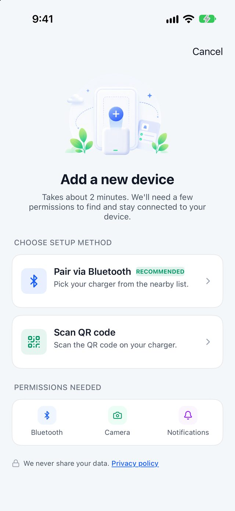
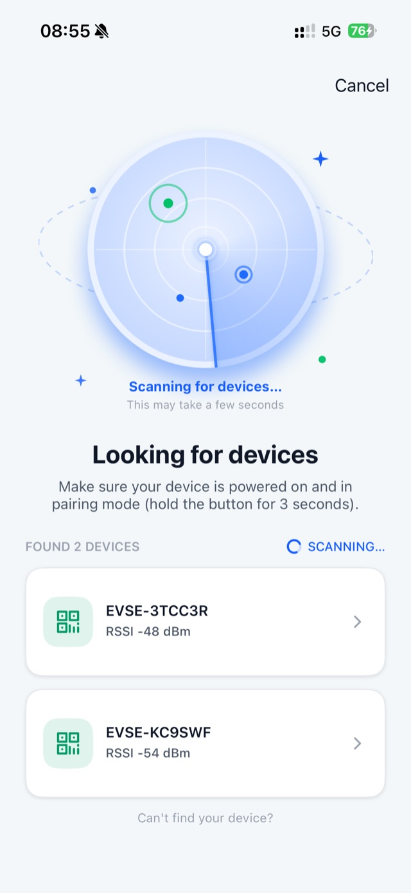
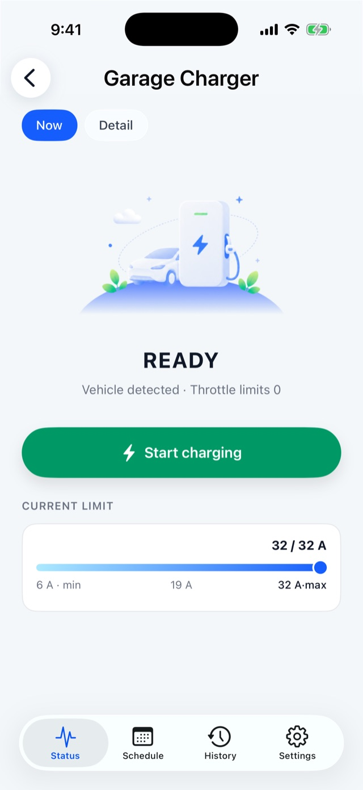
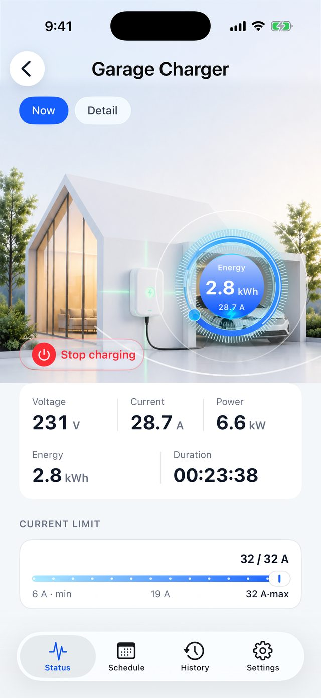
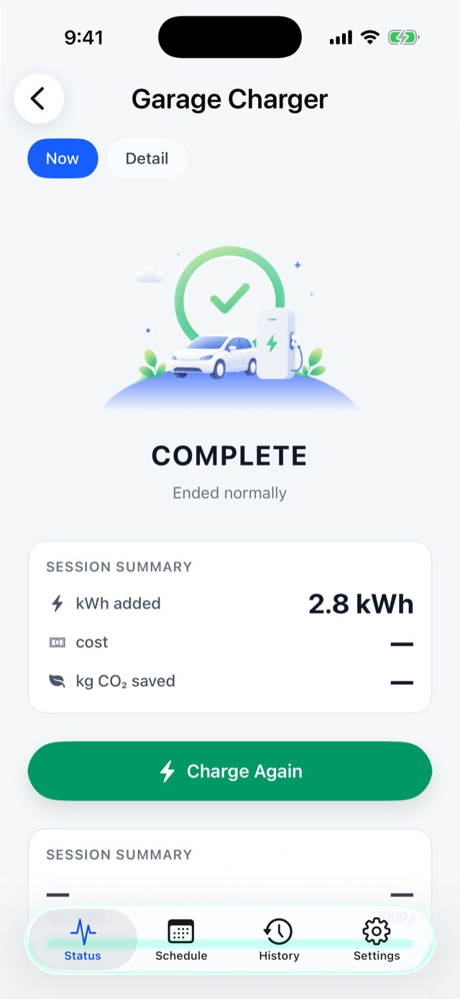
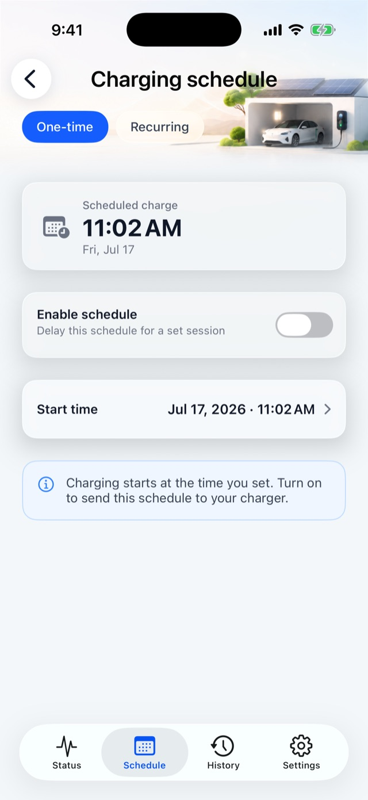
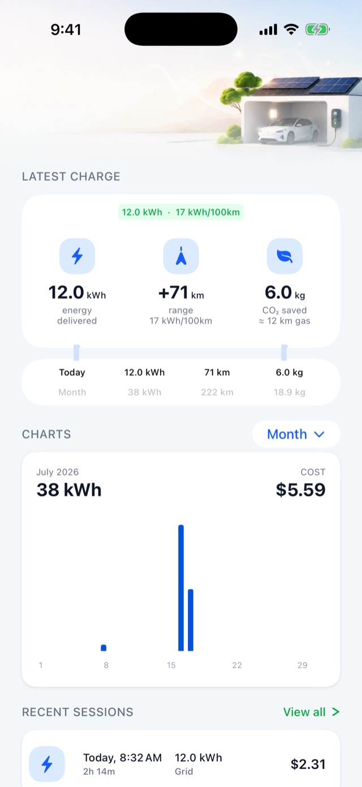
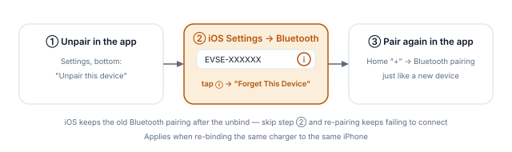

[简体中文](./) · **English**

# BN21 Portable Charger · EVSE Pro App User Manual

> Device: BN21 portable AC charger (model code `bn21-02-eu`, single-phase 230 V / 8 A / 1.84 kW, Type 2 cable, built-in screen)
> App: EVSE Pro v1.7.0 or later · Language: English
> This manual covers only what the BN21 can do. For other models, see the full [EVSE Pro User Manual](https://help.evse.com/manual/); for troubleshooting, see **Me → Help center** in the app.

---

## 0 At a glance {#at-a-glance}

The BN21 is a **Bluetooth-only** portable charger: control it with your phone when you're nearby — **no home Wi-Fi and no account needed**.

| What you can do | Notes |
|---|---|
| ✅ Pair over Bluetooth, start / stop charging | When you're near the charger (within Bluetooth range, usually ~10 m) |
| ✅ Adjust the charging current | 6 – 8 A |
| ✅ Scheduled charging (one-time / weekly) | Runs on time even after your phone leaves |
| ✅ Plug & Charge switch, start / stop with the charger's button | §5 |
| ✅ Screen brightness, dimming, temperature unit | Applies to the charger's own screen |
| ✅ Charging history, cost estimates, export | Stored on your phone |
| ✅ Unpair / hand over | §8 |

| What the BN21 doesn't have | Why |
|---|---|
| ❌ Remote control (when you're away from the charger) | It doesn't connect to the internet — Bluetooth is the only channel |
| ❌ Wi-Fi setup | Same reason; pairing skips this step |
| ❌ Notifications while you're away | Same reason |
| ❌ Sharing the device with family | Not supported in the current version |
| ❌ Firmware updates from the app | Not supported on this model |
| ❌ NFC cards, load balancing, solar | Not in the hardware |

> In short: **every action needs you near the charger with Bluetooth on.** If the app shows "Device offline", move closer and check that Bluetooth is on.

---

## 1 Before you start {#prepare}

1. Install **EVSE Pro** from the App Store.
2. On first launch the app asks for **Bluetooth** access — tap "Allow". It's the BN21's only way to talk to your phone. If you declined, turn it on in iPhone **Settings → Privacy & Security → Bluetooth**.
3. Notifications are optional: the BN21 isn't online, so it doesn't use push notifications. Declining doesn't affect anything.
4. **You don't need an account.** Pairing, control, schedules and history all work signed out. Only **Feedback** requires signing in.

---

## 2 Adding your BN21 (about 1 minute) {#pairing}

Plug the BN21 into a power outlet and wait for its screen to light up. Then tap "Add a device" on the app's home screen (or "+" in the top-right):

1. **Choose a method** — "Pair via Bluetooth", or "Scan QR code": scan the QR code on the charger's label or screen; pairing then continues over Bluetooth. If it won't scan, tap "Search for nearby devices" to pair over Bluetooth directly.
2. **"Looking for devices"** — hold your phone near the charger. A device named like **EVSE-XXXXXX** appears; tap it. When iPhone shows a Bluetooth pairing request, tap "Pair".
3. **"Almost done"** — name the device. The default is its Bluetooth name; change it to something like "Car charger" so it's easy to recognise.
4. **"You're all set"** — tap "Open <device name>" to go to the control screen.

There is no Wi-Fi step for the BN21 — once paired, it's ready.

  Choose a pairing method · Looking for devices

**Can't pair? Check in this order:**

- Is the charger's screen on? Is your phone close enough?
- "This charger is already paired": the BN21 is still paired to someone else's phone (or your old one). Ask the previous owner to unpair it, or factory-reset the charger (§8.3).
- **Just factory-reset?** After a factory reset you **must power-cycle the charger once more** before pairing, otherwise it keeps connecting and dropping. Unplug it, wait 10 seconds, plug it back in, wait for the screen to settle, then pair again.
- Paired it on this iPhone before? Go to iPhone **Settings → Bluetooth**, tap ⓘ next to EVSE-XXXXXX → **Forget This Device**, then pair again in the app (§8.4).

---

## 3 Charging {#charging}

Tap the BN21 card on the home screen to open the device page. It opens on the "Status" tab.

### 3.1 Your first charge

1. Plug the cable into your car. The screen changes from "No cable connected" to "Ready".
2. If needed, drag the "Current limit" slider (6 – 8 A).
3. Tap "Start charging". Tap or swipe "Stop charging" at any time.

> With "Plug & Charge" turned on (§5), charging starts as soon as you plug in — no tap needed.

### 3.2 States you'll see

| State | When | What you can do |
|---|---|---|
| "No cable connected" | Cable not plugged in | Plug in |
| "Ready" | Plugged in, car recognised | Adjust current, "Start charging" |
| Charging | Charging in progress | Adjust current, "Stop charging" |
| "Waiting" / "Scheduled" | A schedule is set and it's not time yet | "Stop charging" to cancel this wait, or "Start now" to charge immediately |
| "Vehicle paused" | The car stopped drawing power (usually reached its own target charge level) | "End charging" to close the session |
| "Charging paused by the charger" | The charger's protection kicked in | Fix the cause, then "Resume" |
| "Complete" | This charge has finished | See the summary, "Charge again" |

   Ready · Charging · Complete (illustrative; your screen may differ)

### 3.3 While charging

- The gauge in the middle shows current power out of 1.84 kW;
- Voltage, current and power are live readings; energy and duration add up for this session. Missing data shows "—", never a made-up 0;
- Duration counts only actual charging time — pauses aren't counted.

### 3.4 Current limit

The BN21 is rated 8 A, so the slider runs **6 – 8 A**. Release the slider or tap a point on it to send the new limit. If the charger rejects it, the slider snaps back and tells you why. Turn it down if the outlet's wiring is old and you're worried about heat.

### 3.5 When your phone leaves

- **Charging carries on**: the charger runs the session itself. Walk away or close the app and it keeps charging until the car is full or you stop it.
- Seeing "Device offline" after you walk away is normal — the BN21 only has Bluetooth. Come back and open the device page to reconnect.
- To stop charging while you're away: you can't. Unplug the cable, or stop it from the app or the charger's button when you're back.

---

## 4 Scheduled charging {#schedule}

Device page → **"Schedule"** tab. Handy for off-peak charging.

| Mode | Settings | Behaviour |
|---|---|---|
| **"One-time"** | A future date + time | Starts once at that time |
| **"Recurring"** | Pick weekdays + one start time | Starts at that time on each chosen day |

Only one mode can be on — turning one on turns the other off.

**How**: set the time first → then turn on "Enable schedule" / "Recurring schedule" (this is when it's sent to the charger) → "Schedule set" means it worked. While the switch is on the time is locked; turn it off to change it.

**Three things to know on the BN21:**

1. **Turn off "Plug & Charge"** (§5) first — otherwise charging starts the moment you plug in and the schedule never applies.
2. The charger runs the schedule itself. Once set, your phone can leave and the app can be closed.
3. **Connect with the app once after a power cut.** When the portable charger is unplugged from the wall, its internal clock is lost. Next time you plug it in, open the app and connect (just open the device page — the app sets the time automatically). Until then, the schedule may run at the wrong time.

 "Schedule" tab · One-time

---

## 5 How charging starts: Plug & Charge and the button {#start-method}

Device page → **"Settings"** → **"Authentication"** → **"Plug & Charge"** switch (you need to be near the charger).

| Plug & Charge | How charging starts |
|---|---|
| **On** | Plug in and it starts — nothing to tap |
| **Off** | Tap "Start charging" in the app, or press the button on the charger |

- **The charger's button works in both modes**, to start or stop charging — so you can stop a charge at the charger even without your phone.
- There's no "How to start charging" option in the BN21's settings. That's expected: its start methods are just the two above, nothing else to choose.
- If you use schedules (§4), remember to turn Plug & Charge off.

---

## 6 Device settings {#settings}

Device page → **"Settings"** tab. The BN21's settings page is shorter than on internet-connected models — no connection, sharing or firmware update rows. That's normal.

| Section | Setting | Notes |
|---|---|---|
| Device card at the top | Tap to rename | Changes the name shown in the app only |
| "Safety" | "Max current" | Read-only, 8 A |
| "Display" | "LCD brightness" + "Auto-adjust" | The charger's own screen; previews as you drag, applies on release |
| "Display" | "Dimmed brightness" / "Dim after" | How dim the idle screen gets, and after how long |
| "Display" | "Screen temperature unit" ℃ / ℉ | Temperature unit on the charger's screen |
| "Authentication" | "Plug & Charge" | See §5 |
| "Firmware & info" | "About this charger" | Model, serial number (double-tap to copy), max power / current, phases, firmware version, lifetime energy |
| "Firmware & info" | "Fault codes" | What each fault code on the charger's screen means and what to do |
| Bottom | "Unpair this device" | See §8 |

> Screen and Plug & Charge settings need you near the charger with Bluetooth connected. If it can't connect, the app asks you to move closer and try again.

---

## 7 History and costs {#history}

### 7.1 Charging history

Device page → **"History"** tab:

- Recent energy / range / CO₂ saved, plus today and this month;
- Weekly / monthly / yearly bar chart;
- "View all" lists sessions by month, with date filters;
- Each session shows energy, cost, start method ("Via app" / "Device button" / "Plug & Charge" / "Scheduled") and stop reason; "Download receipt (PDF)" is available;
- "Export full history (CSV)" opens in Excel or any spreadsheet app.

**Where BN21 history comes from**: the charger records every session itself and syncs it to the app when your phone connects. So:

- It doesn't matter if your phone wasn't around while charging — **the session is filled in next time you open the device page**;
- Plugging in for under 10 seconds without delivering any energy doesn't create a record;
- A field (such as start method) occasionally shows "—": that piece of data wasn't available for that session; it's not an error.

 "History" tab

### 7.2 Electricity price and vehicle efficiency

**Me → Electricity rate / Vehicle efficiency** (global settings — no sign-in, no internet, shared by all your devices):

- **Electricity price**: set time-of-use prices (peak / off-peak) for weekdays, Saturdays and Sundays. Time windows can run past midnight. Once set, history and the "Complete" screen show a cost estimate for each charge. In Australia, the UK, Spain, Italy, Portugal and France you can tap "Import from your electricity company" to pull in your plan (this step needs your phone online).
- **Vehicle efficiency**: set kWh per 100 km (default 17) to convert energy into driving range. Range and CO₂ figures are estimates.

---

## 8 Unpairing, handing over and changing phones {#unpair}

### 8.1 Unpair (near the charger)

Device page → **"Settings"** → **"Unpair this device"** at the bottom → go through the checklist → **"Unpair"**. It takes about 10 seconds; stay near the charger and keep Bluetooth on.

Unpairing clears the pairing on the charger and removes this BN21's history, schedules and display settings from this phone. Afterwards anyone can pair it straight away.

### 8.2 When you're not near the charger

The BN21 can only be unpaired over Bluetooth. Away from it, you can only remove it from this phone: the device disappears from the app, but **the pairing on the charger remains**, so whoever pairs it next has to factory-reset it first (§8.3). Before handing the charger over, unpair it next to the charger if you can.

### 8.3 Factory-reset the charger

1. Unplug the charging cable from the car;
2. Unplug the charger from the wall, then plug it back in;
3. Within 30 seconds of powering on, press and hold the charger's button for about 10 seconds;
4. **Unplug it from the wall and plug it back in once more** (don't skip this — otherwise a new phone can't pair);
5. Wait for the screen to settle, then pair again.

### 8.4 Before pairing again on an iPhone: forget the old Bluetooth pairing

After unpairing or a factory reset, if you're pairing again on the **same iPhone**: go to iPhone **Settings → Bluetooth**, tap ⓘ next to EVSE-XXXXXX → **Forget This Device**, then pair in the app. The system's old pairing isn't removed by unpairing, and leaving it causes repeated connection failures.

### 8.5 Changing phones

The BN21 isn't online, so **a new phone can't take over the old phone's pairing directly**.

- Old phone still works: unpair with it next to the charger (§8.1), then pair with the new phone;
- Old phone lost or broken: factory-reset the charger (§8.3), then pair with the new phone.

History on the old phone doesn't move to the new one. To keep it, use "Export full history (CSV)" before switching.

---

## 9 Messages and alerts {#messages}

Tap the bell in the top-right of the home screen to open Messages. While your phone is connected to the BN21, charging start / finish and alerts (such as over-temperature, over-current, ground fault, abnormal voltage) are recorded here — no sign-in needed.

The BN21 isn't online, so **you get no alerts while your phone is away**; you'll see the latest status when you're back and connected. For what each alert means, see "Alerts" in the Help center; for codes on the charger's screen, see **Settings → Fault codes**.

---

## 10 FAQ {#faq}

| Question | Cause and fix |
|---|---|
| The app says "Device offline" | The BN21 only has Bluetooth: move closer, make sure Bluetooth is on and the charger is powered. If Bluetooth access was denied, allow it in system Settings |
| Can I stop charging when I'm not home? | No. The BN21 isn't online — come back and use the app or the charger's button, or unplug the cable |
| The schedule didn't start on time | ① Is Plug & Charge off? ② After a power cut, did you connect with the app once (§4, point 3)? ③ Does the car have its own schedule, or is it already full? |
| Charging starts as soon as I plug in; the schedule does nothing | Plug & Charge is on — turn it off in Settings |
| No Wi-Fi / sharing / firmware update in Settings | The BN21 doesn't support these — that's normal |
| The charger's button does nothing | Make sure the cable is plugged in and the charger has no fault. If it still doesn't work, flip the Plug & Charge switch once in Settings (on or off, while near the charger) and try again |
| Can't pair after a factory reset | Power-cycle once more after the reset (§8.3 step 4); on the same iPhone, also forget the old Bluetooth pairing (§8.4) |
| "We couldn't confirm whether the command went through" | It doesn't mean it failed — the confirmation timed out. The screen updates on its own shortly; don't keep tapping |
| "Charger no longer paired" | The charger was factory-reset or unpaired by someone else. Tap "Remove device" in the dialog, then pair again |
| A charge is missing from history | Open the device page so your phone connects — it'll be filled in. Plug-ins under 10 seconds aren't recorded |

More help: **Me → Help center**, or sign in and use **Me → Feedback** to open a ticket (leave "Diagnostics" on to help us find the problem).

---

## Appendix: Specifications {#specs}

| Item | BN21 |
|---|---|
| Model code | bn21-02-eu |
| Supply | Single-phase 230 V |
| Rated current / power | 8 A / 1.84 kW (adjustable 6 – 8 A in the app) |
| Connector | Type 2 cable |
| Screen | Yes (display-only) |
| Connectivity | Bluetooth (no Wi-Fi / cloud) |
| Start methods | App, charger button, Plug & Charge |
| NFC cards / load balancing / solar / firmware update from app | Not supported |

---

*Written against the EVSE Pro English UI; features follow the released version. Screenshots are taken from other models, so some details may differ on the BN21.*
