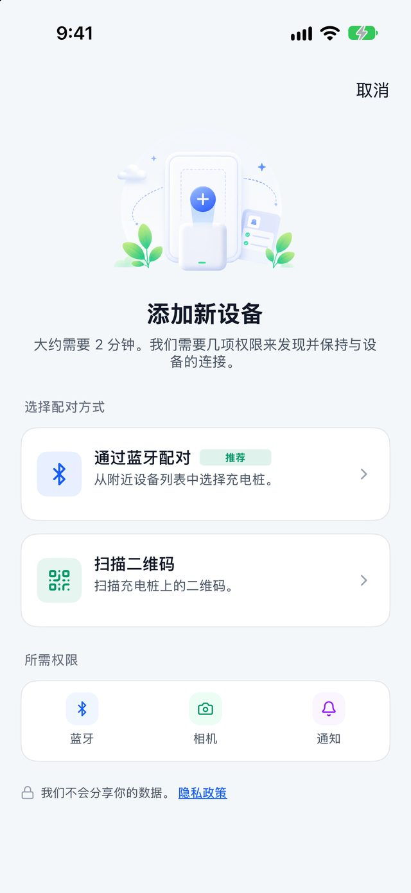
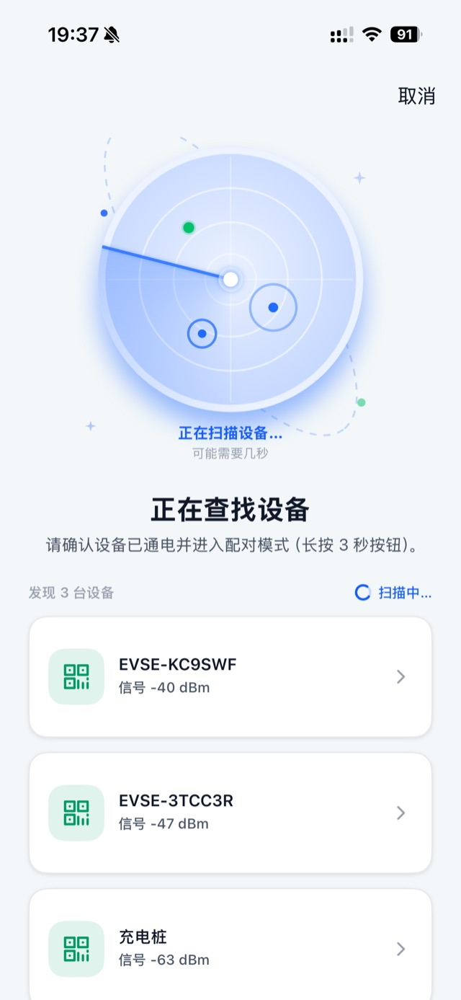
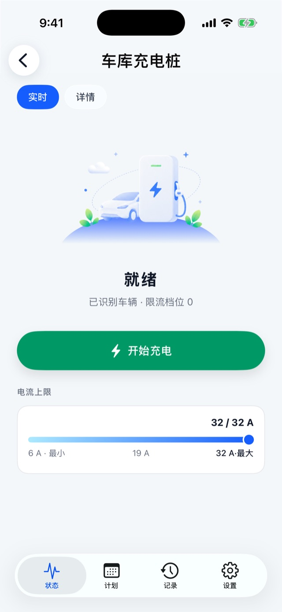
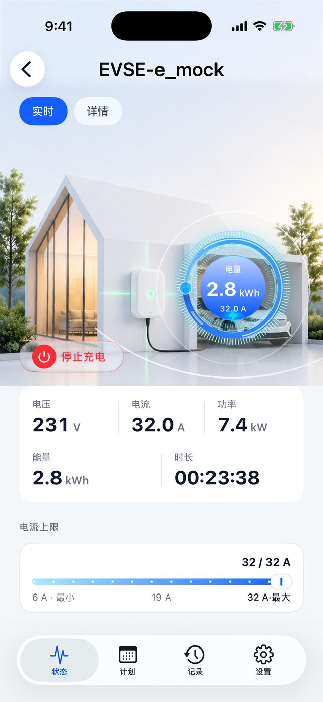
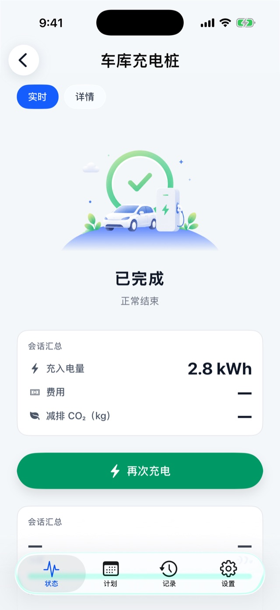
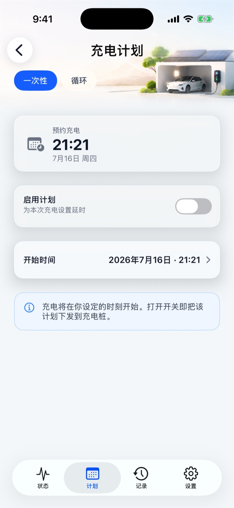
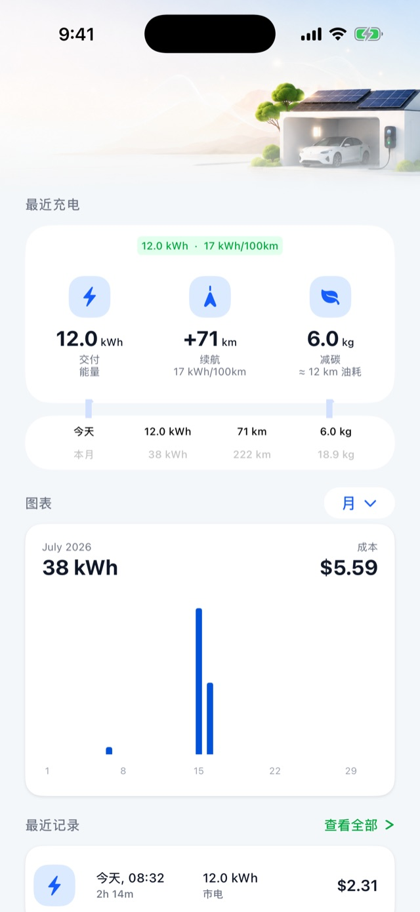
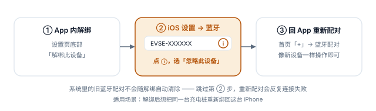

**简体中文** · [English](en.html)

# BN21 便携充电器 · EVSE Pro App 使用手册

> 适用设备：BN21 便携交流充电器（型号码 `bn21-02-eu`，单相 230 V / 8 A / 1.84 kW，欧标 Type 2 枪线，带屏）
> 适用 App：EVSE Pro v1.7.0 起 · 语言：简体中文
> 本手册只讲 BN21 用得到的功能。其他型号的完整功能见[《EVSE Pro 使用功能说明书》](https://help.evse.com/manual/)；排障问答见 App 内「我的 → 帮助中心」。

---

## 0 先看这一页 {#at-a-glance}

BN21 是**纯蓝牙**的便携充电器：手机靠近它就能控制，**不需要家庭 Wi-Fi，也不需要注册账号**。

| 你能做的 | 说明 |
|---|---|
| ✅ 蓝牙配对、开始 / 停止充电 | 人在充电器旁（蓝牙范围内，一般 10 米以内） |
| ✅ 调整充电电流 | 6 – 8 A |
| ✅ 预约充电（一次性 / 每周循环） | 设好后手机离开也照常执行 |
| ✅ 即插即充开关、桩上按键启停 | §5 |
| ✅ 屏幕亮度、降暗、温度单位 | 调的是充电器自带的屏幕 |
| ✅ 充电记录、费用估算、导出 | 数据存在手机上 |
| ✅ 解绑 / 转让 | §8 |

| BN21 没有的 | 原因 |
|---|---|
| ❌ 远程控制（不在充电器旁时操作） | 不联网，只有蓝牙一条通道 |
| ❌ Wi-Fi 配网 | 同上，配对流程里不会出现这一步 |
| ❌ 不在旁边时的推送通知 | 同上 |
| ❌ 设备分享给家人 | 当前版本不支持 |
| ❌ 固件在线升级 | 该型号不支持 App 升级固件 |
| ❌ NFC 刷卡、负载均衡、太阳能 | 硬件不带 |

> 一句话：**所有操作都要人在充电器旁、手机蓝牙打开。** App 显示「离线」时，先走近一点、确认蓝牙已开。

---

## 1 准备 {#prepare}

1. 在 App Store 安装 **EVSE Pro**。
2. 首次打开会请求**蓝牙**权限，请选「允许」——这是 BN21 唯一的通信方式。拒绝过的话，到 iPhone「设置 → 隐私与安全性 → 蓝牙」里打开 EVSE Pro。
3. 通知权限可选：BN21 不联网，用不到推送通知，拒绝也不影响使用。
4. **账号可以不注册。** BN21 的配对、控制、预约、记录都不需要登录；只有「意见反馈」需要登录。

---

## 2 添加 BN21（约 1 分钟）{#pairing}

把 BN21 插上电源插座，等屏幕亮起，然后在 App 首页点「添加设备」（或右上角「+」）：

1. **选择方式**——选「通过蓝牙配对」，或「扫描二维码」：扫描充电器贴纸或屏幕上的二维码，扫码后同样走蓝牙。扫不出时点「直接搜索附近设备」改走蓝牙配对。
2. **正在查找设备**——手机靠近充电器，列表里出现形如 **EVSE-XXXXXX** 的设备，点它。iPhone 弹出系统蓝牙配对请求时点「配对」。
3. **就快完成了**——给设备起名，默认是蓝牙广播名，可改成「车里那台」「车库」等，方便以后辨认。
4. **全部就绪**——点「打开 <设备名>」进入控制页。

BN21 没有 Wi-Fi 步骤，配对完就能用。

  选择配对方式 · 正在查找设备

**配不上？按顺序排查：**

- 充电器屏幕亮着吗？手机离它够近吗？
- 提示「这台充电桩已被绑定」：这台 BN21 还绑在别人（或你以前）的手机上，需要原主人先解绑，或在充电器上恢复出厂（§8.3）。
- **刚恢复过出厂**的 BN21：恢复出厂后**必须再断电重启一次**才能配对，否则会反复连上又断开。拔掉插头，等 10 秒再插上，等屏幕稳定后重新配对。
- 以前在这台 iPhone 上配对过：到 iPhone「设置 → 蓝牙」，点 EVSE-XXXXXX 旁的 ⓘ →「忽略此设备」，再回 App 重新配对（§8.4）。

---

## 3 充电 {#charging}

从首页点 BN21 的卡片进入设备页，默认就是「状态」标签。

### 3.1 第一次充电

1. 把充电枪插进车辆，界面从「未连接充电枪」变成「就绪」。
2. 需要的话拖动「电流上限」滑杆（6 – 8 A）。
3. 点「开始充电」。充电中随时点按或右滑「停止充电」。

> 打开了「即插即充」（§5）的话，插枪就会自动开始，不用点按钮。

### 3.2 界面上会看到的状态

| 状态 | 什么时候出现 | 你能做的 |
|---|---|---|
| 「未连接充电枪」 | 枪没插 | 插枪 |
| 「就绪」 | 枪已插、车已识别 | 调电流、「开始充电」 |
| 充电中 | 正在充 | 调电流、「停止充电」 |
| 「等待中」/「等待预约充电」 | 设了预约、还没到点 | 「停止充电」取消这次等待，或「立即充电」不等预约马上充 |
| 「车辆已暂停」 | 车自己不要电了（多半已到车上设的目标电量） | 「结束充电」生成记录 |
| 「充电已被充电桩暂停」 | 充电器保护动作 | 排除原因后「恢复充电」 |
| 「已完成」 | 本次充电结束 | 看汇总、「再次充电」 |

   就绪 · 充电中 · 已完成（示意图，界面以实际为准）

### 3.3 充电中界面

- 中间的功率表盘按「当前功率 / 1.84 kW」显示进度；
- 电压、电流、功率是实时值，能量、时长是本次累计；拿不到的数据显示「—」，不会显示成 0；
- 时长只算真正在充电的时间，暂停期间不计。

### 3.4 电流上限

BN21 额定 8 A，滑杆范围 **6 – 8 A**。拖动松手或直接点滑杆上的位置即下发；被充电器拒绝时滑杆自动弹回并提示原因。家里插座线路较老、怕发热时可以调低。

### 3.5 手机离开以后

- **正在进行的充电不受影响**：充电器自己管充电，手机走开、App 关掉，都会一直充到车充满或你回来停止。
- 走开后 App 显示「设备离线」是正常的——BN21 只有蓝牙。回到充电器旁打开设备页即可重新连上。
- 想在不在旁时停止充电：只能拔枪，或回来用 App / 桩上按键停止。

---

## 4 预约充电 {#schedule}

设备页 →「计划」标签。适合谷电时段充电。

| 模式 | 设置 | 行为 |
|---|---|---|
| **一次性** | 未来某个日期 + 时刻 | 到点自动开始一次 |
| **循环** | 每周选几天 + 一个统一时刻 | 每逢选中的日子到点开始 |

两种模式只能开一个，开一个会自动关另一个。

**操作**：先设时间 → 再打开「启用计划」/「循环计划」开关（这一刻才发给充电器）→ 提示「已设置预约充电」即成功。开关开着时时间不能改，要改先关掉。

**BN21 预约三个要点：**

1. **先关掉「即插即充」**（§5），否则一插枪就立即开始充，预约不起作用。
2. 预约由充电器自己按时执行，设好后手机离开、App 关闭都没关系。
3. **BN21 断电后要用 App 连一次。** 便携充电器拔下插头后内部时钟会丢失，下次插上电时请打开 App 连一下（进入设备页即可，App 会自动校准时间），预约才会按正确时间执行。没连之前，预约可能不准。

 「计划」标签 · 一次性

---

## 5 启动方式：即插即充与桩上按键 {#start-method}

设备页 →「设置」→「充电鉴权」→「即插即充」开关（需在充电器旁）。

| 即插即充 | 怎么开始充电 |
|---|---|
| **开** | 插枪即开始，什么都不用点 |
| **关** | 用 App 点「开始充电」，或按充电器上的按键 |

- **桩上按键在两种模式下都能用**，可以用来开始或停止充电——手机不在身边时也能在充电器上直接停。
- BN21 设置页里没有「如何开始充电」选项，这是正常的：它的启动方式就是上表这两种，不需要另外选。
- 想用预约（§4），记得把即插即充关掉。

---

## 6 设备设置 {#settings}

设备页 →「设置」标签。BN21 的设置页比联网型号短，没有「连接」「分享」「固件更新」这些行，属正常。

| 分组 | 设置项 | 说明 |
|---|---|---|
| 顶部设备卡 | 点击改名 | 改的只是 App 里的显示名 |
| 安全 | 最大电流 | 只读，8 A |
| 显示 | 屏幕亮度 + 自动调节 | 调充电器自带屏幕，拖动实时预览、松手生效 |
| 显示 | 降暗亮度 / 降暗延时 | 屏幕空闲多久后变暗、暗到多少 |
| 显示 | 温度单位 ℃ / ℉ | 充电器屏幕上的温度单位 |
| 充电鉴权 | 即插即充 | 见 §5 |
| 固件与信息 | 关于此充电桩 | 型号、序列号（双击可复制）、最大功率 / 电流、相数、固件版本、累计充电量 |
| 固件与信息 | 故障码说明 | 充电器屏幕上故障码的含义与处理建议 |
| 底部 | 解绑此设备 | 见 §8 |

> 屏幕、即插即充等设置都需要人在充电器旁、蓝牙已连。连不上时会提示「靠近后重试」。

---

## 7 充电记录与费用 {#history}

### 7.1 充电记录

设备页 →「记录」标签：

- 最近充电的电量 / 续航 / 减碳统计，今天 / 本月汇总；
- 周 / 月 / 年充电量柱状图；
- 「查看全部」按月分组，可按日期筛选；
- 单条详情：电量、费用、开启方式（App 启动 / 按键启动 / 即插即充 / 预约启动）、停止方式；可「下载回执（PDF）」；
- 「导出完整历史（CSV）」可在电脑上用 Excel 打开。

**BN21 的记录怎么来的**：充电器自己记录每次充电，手机连上时同步到 App。所以：

- 充电时手机不在旁也没关系，**下次打开设备页时会自动补上**；
- 插枪不到 10 秒、一点电没充进去的「空插」不会生成记录；
- 偶尔个别字段（如开启方式）显示「—」，表示这次没拿到这项数据，不是出错。

 「记录」标签

### 7.2 电价与车辆能耗

「我的 → 电价 / 车辆能耗」（全局设置，不用登录、不用联网，所有设备共用）：

- **电价方案**：按工作日 / 周六 / 周日设置分时电价（峰 / 平 / 谷），时段可以跨夜。设好后记录和「已完成」页会显示每次充电的费用估算。澳洲、英国、西班牙、意大利、葡萄牙、法国用户可点「从电力公司导入」直接导入套餐（这一步需要手机联网）。
- **车辆能耗**：设置百公里电耗（默认 17 kWh），用来把电量换算成续航里程。里程与减碳都是估算值。

---

## 8 解绑、转让与换手机 {#unpair}

### 8.1 解绑（在充电器旁）

设备页 →「设置」→ 底部「解绑此设备」→ 按清单确认 →「解绑」。全程约 10 秒，请站在充电器旁、别关蓝牙。

解绑会：解除充电器上的绑定，并清除本机上这台 BN21 的充电记录、预约、显示设置等。解绑后任何人都能直接重新配对它。

### 8.2 不在充电器旁时

BN21 只能通过蓝牙解除绑定。人不在旁边时只能「从本机移除」：App 里的设备没了，但**充电器上的绑定还在**，之后谁要再配对它，都得先在充电器上恢复出厂（§8.3）。所以转让前，请尽量在充电器旁完成解绑。

### 8.3 在充电器上恢复出厂

1. 拔下充电枪；
2. 拔掉电源插头，再插上；
3. 通电后 30 秒内，长按充电器按键约 10 秒；
4. **再拔插一次电源**（这一步不能省，否则新手机配不上）；
5. 等屏幕稳定后重新配对。

### 8.4 iPhone 重新配对前：忽略旧蓝牙

解绑或恢复出厂后，如果要在**同一台 iPhone** 上重新配对：先到 iPhone「设置 → 蓝牙」，点 EVSE-XXXXXX 旁的 ⓘ →「忽略此设备」，再回 App 配对。系统里的旧配对不会随解绑自动清除，不忽略会反复连接失败。

### 8.5 换手机

BN21 不联网，**新手机无法直接接管旧手机的绑定**。

- 旧手机还能用：在充电器旁用旧手机解绑（§8.1），再用新手机配对；
- 旧手机已丢失 / 损坏：在充电器上恢复出厂（§8.3），再用新手机配对。

旧手机上的充电记录不会迁移到新手机；需要保留的话，换机前先「导出完整历史（CSV）」。

---

## 9 消息与提醒 {#messages}

首页右上角铃铛进入消息中心。手机连着 BN21 时，充电开始 / 完成、告警（如过温、过流、接地故障、电压异常）会记录在这里，不用登录。

BN21 不联网，**手机不在旁时收不到任何通知**，回来连上后才会看到新状态。告警含义见帮助中心「告警说明」，充电器屏幕上的故障码见「设置 → 故障码说明」。

---

## 10 常见问题 {#faq}

| 问题 | 原因与处理 |
|---|---|
| App 显示「离线」 | BN21 只有蓝牙：走近充电器、确认手机蓝牙已开、充电器已通电。蓝牙权限被拒的话到系统设置里允许 |
| 不在家时能停止充电吗？ | 不能。BN21 不联网，只能回来用 App、桩上按键，或拔枪 |
| 预约没按时开始 | ①即插即充是否已关；②充电器断过电后是否用 App 连过一次（§4 要点 3）；③车辆自身是否设了预约或已充满 |
| 插枪就开始充，预约没用 | 即插即充开着，到「设置」关掉 |
| 设置页找不到 Wi-Fi / 分享 / 固件更新 | BN21 不支持这些功能，正常 |
| 充电器上按键没反应 | 先确认已插枪、充电器无故障；仍无效时到「设置」把即插即充开关拨一下（开或关都行，需在充电器旁），再试 |
| 恢复出厂后配不上 | 恢复出厂后要再断电重启一次（§8.3 第 4 步）；同一台 iPhone 还要先忽略旧蓝牙（§8.4） |
| 提示「未能确认命令是否生效」 | 不代表失败，只是确认超时，稍等界面会自动更新，别反复点 |
| 提示「充电桩已解绑」 | 充电器被恢复出厂或被别人解绑了，按弹窗「移除设备」后重新配对 |
| 记录里少了一次充电 | 打开设备页让手机连上，记录会自动补上；不到 10 秒的空插不记录 |

更多问题：「我的 → 帮助中心」；或登录后「我的 → 反馈」提交工单（建议打开「诊断信息」开关，便于定位）。

---

## 附录 规格速查 {#specs}

| 项目 | BN21 |
|---|---|
| 型号码 | bn21-02-eu |
| 供电 | 单相 230 V |
| 额定电流 / 功率 | 8 A / 1.84 kW（App 可调 6 – 8 A） |
| 接口 | 欧标 Type 2 枪线 |
| 屏幕 | 有（只读显示屏） |
| 通信 | 蓝牙（无 Wi-Fi / 云端） |
| 启动方式 | App、桩上按键、即插即充 |
| NFC 刷卡 / 负载均衡 / 太阳能 / App 固件升级 | 不支持 |

---

*本手册以 EVSE Pro 简体中文界面文案编写，功能以实际发布版本为准。示意截图取自其他型号，界面细节可能与 BN21 略有不同。*
